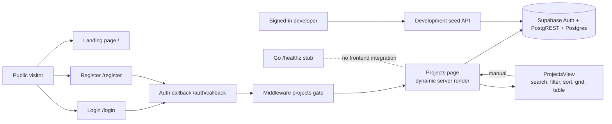
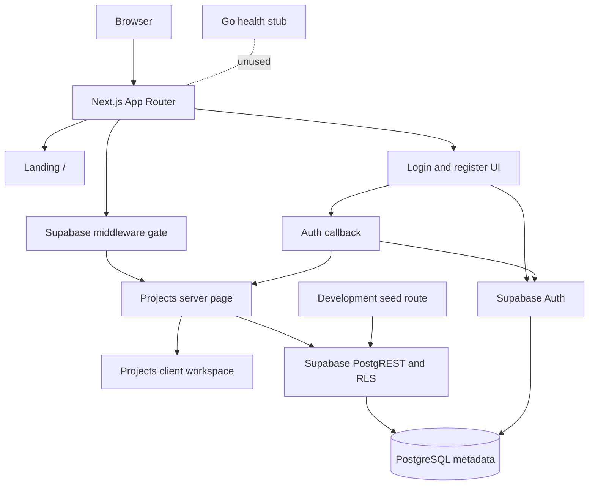

# PROJECT_CURRENT_STATE.md

> Volatile delivery snapshot for **DevOps Safeguard**.
> Inspection date: **2026-09-29**.
>
> Use this file to determine what is implemented, broken, pending, or planned.
> Use `PROJECT_TECHNICAL_CONTEXT.md` for durable architecture and contracts.
>
> There is **no `.git` directory** in this worktree, so there is no Git
> history available here. “Recent work” below is based on repository code and
> `Docs/PROJECT_STATE.md`, not commits.

## Phase 2 delivery update — 2026-09-30 (operational workflow)

> **This section supersedes the Phase-1 framing below.** The forensic Q1–Q26
> snapshot was written on 2026-09-29 and states there is no incident, detection,
> or AI implementation. That is **no longer true** — sections **Q9, Q10, Q11**
> and parts of **Q10/Q15** describe the pre-Phase-2 state and are superseded
> here. Everything in this section is verified **locally** (unit tests + an RLS
> harness against a throwaway Postgres); it has **not** been exercised against
> the remote database, which still has no schema.

The full incident lifecycle now exists as real, project-scoped, RLS-protected
code: **observe → detect → investigate → evidence → AI analysis → human approval
→ remediation → verification → resolve → report.** No fabricated telemetry, no
fake download buttons; AI is read-only and every remediation is human-gated.

### §29 Checkpoint

**COMPLETED (code-complete, in the repository)**

- Two additive migrations: `20261001000000_incident_domain.sql` (services,
  incidents, incident_events, incident_evidence, ai_analyses, remediation_actions
  + `can_access_project`/`can_access_incident` SECURITY DEFINER helpers + full
  RLS) and `20261002000000_detection_and_verification.sql` (service_health_checks,
  verification_runs, and a DB-level `action_type` allowlist CHECK — no
  arbitrary-command value exists).
- `lib/`: `incidents.ts` + `incidents/load.ts` (one shared bundle loader);
  `detection/monitor.ts` (writes observed checks incl. labelled simulation) +
  `detection/reconcile.ts` (open/dedup/recovery — OBSERVE→DETECT, never
  BUTTON→INCIDENT); `ai/*` (provider abstraction + deterministic test provider +
  validated structured output, read-only, hedged); `remediation/actions.ts`
  (typed allowlist, fails closed) + `remediation/engine.ts` (human-approved, demo
  services only); verification via `verification_runs` (N consecutive healthy).
- UI: `/projects/[id]` dashboard integration (Operations card + clickable
  incident rows); `/projects/[id]/incidents/[incidentId]` detail (header, impact,
  timeline, grouped evidence, "occurred shortly before" related changes, violet
  AI panel); `/projects/[id]/incidents/[incidentId]/report` print report + real
  JSON export route handler.
- Docs updated: this file, `docs/PROJECT_STATE.md`, `docs/Architecture.md`.

## Phase 3 delivery update — 2026-10-02 (data integrity + onboarding trust)

> **Supersedes:** the "BLOCKED — needs you" section below. The owner pushed
> `20261003000000_project_onboarding.sql`; **all six migrations are now applied**
> to the linked remote project. `project_configs` and `project_env_vars` exist.

### What was wrong

Five defects made the wizard state things it could not support:

1. **Onboarding config was write-only.** `project_configs` / `project_env_vars`
   were written by `createProjectFromOnboarding` and read by **nothing**. Every
   value captured in steps 1–9 was dead data, and the dashboard hard-coded
   "Not available" for deployment.
2. **Phantom PostgreSQL.** `suggestDependenciesFromAnalysis` substring-matched
   dependency names against **every file path**, so any repo containing
   `app/page.tsx` reported PostgreSQL as `Auto-detected` (the letters "pg").
3. **Fabricated commands / versions.** `uvicorn app:app --host 0.0.0.0 --port
   8000`, `./api`, `"Node.js 20"` — none of it read from the repository.
4. **`monitoring_status: "active"` written at creation**, before any check ran.
5. **Invented health endpoint.** `emptyWizardState().health.endpoint` was
   pre-filled with `/api/health`.

### What changed

- **Dependency evidence is now tiered.** `detected` requires service-specific
  evidence (`POSTGRES_*` env var, or port 5432 in compose/k8s). A driver
  package or a bare `DATABASE_URL` yields `unknown` — a package name alone does
  not prove a live dependency. Filenames are never consulted.
- **`package.json` scripts are captured** (`RepoAnalysis.scripts`) and `dev` /
  `build` / `start` are three separate fields with independent provenance.
  `devCommand` is never a fallback for the production start command.
- **`monitoring_status` is no longer written**; the column default `pending`
  stands until a real check reports.
- **`emptyWizardState().health.endpoint` is empty.** A fresh wizard cannot pass
  health validation without an endpoint from analysis or the user.
- **Generated Supabase types** (`lib/supabase/database.types.ts`, regenerate
  with `npm run db:types`) now type all three clients. A non-existent column is
  a compile error, not a runtime surprise.
- **Dashboard reads the config back** via `lib/project-config.ts`, rendering a
  "Monitoring configuration" card. The env-var query selects
  `key, is_secret, has_value` only — `value` is never requested, so a secret
  cannot reach a server component even if a row were malformed.
- **UX:** stepper shows the full step name for the active step only (no more
  `B…`/`R…` truncation; every station has a full `aria-label` + `title`);
  deployment step names the evidence it found; Setup Complete states
  Configuration saved / Monitoring configured / First check pending.

### Verified

- `npm run verify` clean; `npm run test:unit` **85/85** (+16 new detection tests).
- Isolated production build compiles.
- **Live round trip against the remote database:** completed the wizard, then
  confirmed the dashboard read back `monitoring_status = pending`, the three
  distinct runtime commands, the health method/endpoint/schedule, env-var and
  secret counts, and `unknown` dependency tiers.

### Known limitations

- `npm run test:db` (RLS harness) needs Docker Desktop, which was not running.
  The migrations themselves are proven applied remotely.
- **Pre-existing, untouched:** the wizard draft is restored from `localStorage`
  after mount, so server HTML and the first client render disagree (Next dev
  overlay "hydration" error in `WizardStepper`/`AddProjectWizard`). Fixing it
  changes draft-persistence behaviour and was left out of scope.
- The verification project ("Rookies") contains ~69 environment variables
  inherited from an existing browser draft. It is a test artifact — delete it
  from `/projects` when convenient.

<!-- __CHECKPOINT_2__ -->
**TESTED (executed this round, passing)**

- `npm run test:unit` → **31/31** (ai-schema validation, deterministic provider,
  detection reconcile, remediation allowlist).
- `npm run typecheck` (`tsc --noEmit`) clean; `next lint` clean.
- Production build succeeds via `NEXT_BUILD_DIR=.next-verify npm run build`
  (isolated dir so it doesn't collide with a live `next dev` on shared `.next`);
  the incident detail, report, and export routes are all present in the route
  table.
- **RLS harness PASSED** against a throwaway `postgres:17-alpine`
  (`supabase/tests/run.sh`, executed here; `run.ps1` was updated to identical
  coverage for Windows but not re-run in this environment): all six migrations
  apply cleanly; Phase 1 + Phase 2 assertions pass — including new
  `service_health_checks` / `verification_runs` tenant isolation, verification
  defaults, and the `action_type` allowlist rejecting `EXECUTE_ARBITRARY_COMMAND`.
  A project/incident id is never enough by itself to read or write another
  tenant's rows.

**NOT YET VERIFIED (built, but not exercised in a running system)**

- The end-to-end workflow *through the UI* against a real database
  (controlled failure → detection → … → resolved → report). Proven only at the
  unit + SQL-RLS level, because the remote DB has no schema yet.
- AI analysis against a **live** LLM provider — only the deterministic test
  provider has been run (no live provider is required for the demo).
- Gentle realtime/refresh behaviour under a live server.

**BLOCKED (needs you — I must not fabricate a DB application)**

- The Supabase CLI is present but the project is **not linked** in this
  environment, so I cannot push. Run, as the project owner:
  ```sh
  supabase login
  supabase link --project-ref afbuzhsnnczfawuwnglr
  supabase db push
  ```
  This applies all five `public.*` migrations in order.

**NEXT PHASE**

1. After the push, manually exercise the full loop on a demo project.
2. Add a browser/E2E acceptance test (deterministic AI provider only).
3. Then the `/projects/new` Add Project wizard.
4. **Do NOT deploy yet** (per the active directive).

## Phase 4 delivery update - 2026-10-02 (repository analysis)

### What was wrong

`/projects/new` step 3 reported *"Analysis unavailable — we could not read any
recognised configuration files"* for `github.com/stefanprodan/podinfo`, a
repository that has a Dockerfile, `go.mod`, Docker Compose, Kustomize and Helm
at the root of `charts/`. Three independent causes:

1. The route fetched a fixed, **root-only** `ANALYSIS_CANDIDATE_PATHS` list one
   file at a time through the GitHub Contents API. `charts/**` and
   `kustomize/**` were never requested, so Helm and Kustomize were invisible
   even on a healthy request.
2. Every non-`200` response — `403`, `404`, `429`, network error — was folded
   into `missing`. The unauthenticated GitHub quota (`60`/hour) was exhausted,
   so `403`s were reported as *"no such file"*, which is both wrong and
   unactionable.
3. `exec` container probes (`["CMD", "/podinfo", "--healthz"]`) and Compose
   port forms were not parsed, so `/healthz` and port `9898` were missed, and
   Kubernetes detection ignored `kustomization.yaml`.

### What changed

- `lib/onboarding/discovery.ts` — one recursive Git Trees call feeds a bounded,
   deterministic selector (depth `5`, `120` files, `400 KB`/file, `3 MB`
   total) that skips vendored/generated/binary paths. `truncated` is reported,
   never silently hidden.
- `lib/onboarding/github.ts` — repo metadata → tree → selected files, fetched
   from `raw.githubusercontent.com` with a Contents-API fallback, plus a
   `failure` taxonomy: `no_url`, `unsupported_host`, `repo_unreachable`,
   `branch_not_found`, `rate_limited`, `read_failed`. A `403` with a spent
   `x-ratelimit-remaining: 0` is reported as `rate_limited`, not "no files".
- `lib/onboarding/analyze.ts` — nested Helm/Kubernetes/Kustomize/Compose
   discovery, `exec` + `httpGet` probe parsing, Compose port forms, explicit
   `containerPort` values kept ahead of loose mappings, and a path recorded as
   evidence for **every** detected finding (framework, language, package
   manager, ports, health endpoints, Dockerfile, Compose, Kubernetes, Kustomize,
   Helm, CI, entry points).
- `components/onboarding/steps/StepAnalysisDeploy.tsx` — renders the evidence
   path under each finding and states when the tree was truncated.

### Verified

- `npm run verify` (`tsc --noEmit` + `next lint`) clean.
- `npm run test:unit` → **113/113** (added 4 provenance tests plus the
  discovery/failure regressions).
- Isolated production build succeeds (`NEXT_BUILD_DIR=.next-verify`).
- **Live**, against `stefanprodan/podinfo @ master`: `status: ready`,
  `failure: null`, Go ← `go.mod`, Dockerfile, Compose, Kubernetes, Kustomize,
  Helm, CI ← `.github/workflows/cve-scan.yml`, entry point
  `cmd/podcli/main.go`, ports incl. `9898`, health `/healthz` + `/readyz`.
- Wizard re-run in the browser reaches **Step 3 "Detected configuration"** with
  an evidence path beside each finding and no console errors.

### Known limitations

- GitHub analysis uses the **unauthenticated** `60 requests/hour` quota; it is
  reported honestly when exhausted, but repeated runs can hit it.
- The port list is the honest union of every port in the downloaded manifests,
  so infrastructure ports (OTel `4317`, Prometheus `3000`, MySQL `3306`) sit
  next to the application port. Runtime auto-fill may prefer a common port
  over the app's own.
- Only public GitHub is supported; other hosts get an explicit manual message.
- `npm run test:db` still needs Docker Desktop (unrelated to this change).

## Phase 5 delivery update - 2026-10-02 (evidence-driven onboarding)

### What was wrong

Seven defects made onboarding claim configuration it could not support:

1. **Silent deployment choice.** Analysis auto-selected `kubernetes` whenever
   manifests existed, so Step 4 and Review could disagree with the actual
   deployment (Helm).
2. **Flat port union.** Every number found anywhere became a candidate and
   Step 6 preferred common ports (`3000`) over the real application port
   (`9898`); Service `port: 80` was indistinguishable from the container
   target `9898`.
3. **Stale `npm start`.** A previous Node draft's detected start command
   survived re-analysis of a Go repository.
4. **Weak dependencies marked active.** A bare port, driver package, or
   disabled Helm subchart could report a dependency as active.
5. **Target and path conflated.** Step 8 accepted a full URL in the endpoint
   field; liveness/readiness probes were indistinguishable from the
   functional check.
6. **Review re-derived values** instead of rendering canonical state, and the
   dashboard kept a second strategy-label map.
7. **No real check execution.** Onboarding stored a monitoring target nothing
   ever fetched, so the fault experiment could not demonstrate detection.

### What changed

- **Evidence model** (`lib/onboarding/evidence.ts`, `types.ts`): every finding
  carries `sourcePath`, optional `field`/`line`, `evidenceType`,
  `semanticRole`, `confidence` (high/medium/low), and an explanation. `unknown`
  provenance now exists alongside `not_detected`.
- **Structured parsing without new dependencies**: a minimal YAML-subset
  parser (`yaml.ts`, bounded nodes/depth for untrusted input), static Helm
  analysis (`helm.ts`: values defaults, `if` evaluation, `.Values`
  substitution — templates are never executed), Kubernetes relationship
  extraction (`kubernetes.ts`: selector→label binding, named targetPort
  resolution, K8s targetPort default), Dockerfile/Compose parsing
  (`containers.ts`).
- **Semantic ports** (`ports.ts`): roles (application_http/https, metrics,
  grpc, database, cache, message_queue, telemetry, service, ingress,
  node_port, unknown) and a deterministic ranking that only ever selects an
  application-facing candidate; ties stay ambiguous for the user.
- **Commands** (`commands.ts`): K8s container command/args, Helm defaults,
  Compose/Dockerfile/package scripts kept as dev/build/production facts that
  never fall into one another; non-Node repos never receive npm commands.
- **Dependency tiers** (`dependencies.ts`): strong/medium → Detected,
  weak → Not confirmed (`unknown`), disabled/absent → Not detected. Explicit
  `redis.enabled: false` beats the installed driver.
- **Health model** (`health.ts`, `health-evidence.ts`): separate target URL +
  endpoint path with safe joining; probe roles (liveness/readiness/startup)
  preserved apart from application routes.
- **Single canonical configuration** (`configuration.ts`, `deployment.ts`,
  `stored-config.ts`): analysis only suggests; Step 4 selection is the one
  strategy everywhere (shared labels); Review/persistence/dashboard consume
  `buildCanonicalConfiguration`; stored JSON is narrowed by pure,
  unit-tested normalizers (no relational migration needed — `project_configs`
  is intentionally JSONB).
- **Real check execution** (`lib/monitoring/http-check.ts`,
  `app/projects/[id]/health-actions.ts`): "Run HTTP check" performs the
  configured target+path check with timeout, SSRF guards (no credentials,
  internal hostnames blocked, resolved addresses must be public, no redirect
  following, bodies never stored), records a `source='external'` observation,
  and lets the existing detector decide (OBSERVE → DETECT preserved).

### Verified

- `npm run verify` clean; `npm run test:unit` → **172/172** (ports,
  commands, dependencies, health, configuration round-trip, failures,
  provenance, HTTP classifier suites).
- Isolated production build compiles (`NEXT_BUILD_DIR=.next-verify`).
- **Live Podinfo E2E** (`stefanprodan/podinfo @ master`, Helm): Go, app
  port 9898 selected with 17 evidence lines, Helm-derived production
  command, no npm anywhere, Redis/MySQL Not detected, target + `/` with
  exact checked-URL preview, Review == persistence == dashboard read-back.
- **Runtime fault experiment** against the Quick Tunnel target: baseline
  `GET / → 200` healthy; fault injection on → `/ → 500` while
  `/healthz`, `/readyz` stayed 200; three consecutive failing checks kept
  one critical incident open (no duplicates); fault off → three healthy
  checks verified recovery (3/3) and resolved. Fault left disabled, app 200.

### Known limitations

- No background scheduler or notifier exists yet: checks run on demand, and
  the stored failure threshold governs recovery verification, not detection
  gating (a first critical reading still opens an incident immediately).
- Health `method: port/container` has no executor; only HTTP checks execute.
- GitHub analysis still uses the unauthenticated 60/hour quota (honestly
  reported as `rate_limited`).
- `npm run test:db` needs Docker Desktop, which was not running; no
  migrations were added or altered in this change.
- Dev-mode note (environment, not app code): two concurrent `next dev`
  servers sharing `.next`, plus test/build churn mid-session, corrupted dev
  vendor chunks (`__webpack_modules__[moduleId] is not a function`,
  missing `vendor-chunks`). Clean stop + `npm run clean` + single-server
  restart resolved it; production build was never affected. Do not run
  `test:unit`/builds while verifying in dev.

## Q1. Project overview

### Implemented scope

DevOps Safeguard is currently a **Phase 1 foundation**, not a working
monitoring product. It can:

1. Present a public marketing landing page.
2. Register users with email/password and verify them with a Supabase
   six-digit signup OTP.
3. Sign users in and out with Supabase sessions.
4. Show an authenticated, RLS-scoped project list with search, filters,
   sorting, grid/list views, refresh, loading/empty/error states, and
   development-only sample data.
5. Expose a Go `/healthz` stub that is not connected to the frontend.
6. Store project metadata in Supabase/PostgreSQL once migrations are applied.

### Problem and users

The intended problem is fragmented application/infrastructure observability
and difficult failure investigation. Current actual users are:

- Public visitors evaluating the concept.
- Developers creating accounts and signing in.
- Signed-in users who can view project metadata after the database is set up.

### What must not be assumed

There is no live collection, detection, correlation, incident management,
Kubernetes integration, log/metric backend, alerting, security scanning, AI
runtime, project creation wizard, project dashboard, or production
deployment in the current code.

## Q2. Complete tech stack

| Category | Current implementation | Exact version/source |
|---|---|---:|
| Frontend framework | Next.js App Router | `14.2.13` |
| UI runtime | React / React DOM | `18.3.1` |
| Language | TypeScript | `5.6.2`, strict |
| Styling | Tailwind CSS | `3.4.13` |
| CSS toolchain | PostCSS / Autoprefixer | `8.4.47` / `10.4.20` |
| Fonts | `next/font/google`, Inter + JetBrains Mono | Next.js font system |
| Icons | `lucide-react` | `^1.48.0` |
| Motion | `motion` | `^13.4.4` |
| Class utilities | `clsx`, `tailwind-merge` | `^2.1.1`, `^3.7.0` |
| Backend framework | None; Go stdlib HTTP mux | Go module requires `go 1.23` |
| Backend language | Go | No Go dependencies |
| Database | PostgreSQL | Local config uses major version `17` |
| Auth/database provider | Supabase JS + SSR | `@supabase/supabase-js ^2.117.2`, `@supabase/ssr ^0.12.7` |
| Supabase CLI | Used for link/push/test workflow | Docs record `2.118.0`; not independently verified |
| Package manager | npm | `package-lock.json` present |
| Build tool | Next.js | `next build` / `next start` / `next dev` |
| Lint | ESLint + Next config | `8.57.1` + `eslint-config-next 14.2.13` |
| Type checking | `tsc --noEmit` | TypeScript `5.6.2` |
| Database tests | Plain SQL + Docker Postgres | Test image `postgres:17-alpine` |
| State management | React context, component state, router/search params | No Redux, Zustand, React Query, or form library |
| Validation | Regex/whitelisting, enum narrowing, DB checks | No Zod/Yup/Formik/React Hook Form |
| Unit/integration/e2e framework | None | Only the database SQL harness |
| Deployment tooling | None | No Docker, CI, IaC, or hosting manifests for the app |
| Cloud/hosted service | Supabase remote project configured by environment | Migration push still pending |
| Monitoring/observability | None | Mentioned only in docs/design/marketing |
| AI/LLM | None | No provider, SDK, model, prompt, tool, or cost |
| Developer CLIs | npm, Supabase CLI, Docker for DB tests | Go toolchain reported unavailable in project notes |

## Q3. Architecture

### Actual current architecture

- Browser requests hit Next.js App Router.
- Public landing, login, register, and auth callback render without a project
  database dependency.
- Middleware matches only `/projects/:path*`, refreshes sessions, verifies
  auth, fails closed, and forwards a verified user ID downstream.
- `/projects` runs as a dynamic server component reading RLS-scoped rows.
- `ProjectsView` is a client workspace for filtering, sorting, and display.
- `/api/dev/seed` creates/removes sample rows under the caller’s RLS access.
- The Go service is standalone and unused.
- There are no collectors, queues, observability backends, inference
  services, background jobs, or WebSocket/SSE streams.



## Q4. Repository structure

Stable responsibilities are in `PROJECT_TECHNICAL_CONTEXT.md`. Current status
per area:

- `app/`
  - Landing, login, register, callback, projects, and dev seed route exist.
  - Missing: `/projects/new`, `/projects/:projectId`, password flows,
    profile/account, operations, settings, and API routes beyond dev seed.
- `components/landing/`
  - Fourteen implemented marketing components.
  - Static/illustrative operational examples, not live data integrations.
- `components/auth/`
  - Session provider, auth shell, OTP form, sign-out, and greeting.
- `components/projects/`
  - Health badges/dots, cards, table, filters, controls, refresh, demo
    controls, and database notices.
- `components/ui/`
  - Reused cards, badges, buttons, inputs/auth motion, icons, section
    headings, terminal/background visuals.
- `lib/`
  - Project model, RLS-aware Supabase factories, auth-error mapping, site
    constants, and class-name helper.
- `backend/`
  - Only `go.mod`, README, and `cmd/api/main.go`.
- `supabase/migrations/`
  - Three ordered migrations for core tables, profile trigger, telemetry
    fields, and RLS repairs.
- `supabase/tests/`
  - Auth stub, behavioral assertions, and disposable-container runner.
- `supabase/config.toml`
  - Local development service configuration.
- `Docs/`
  - Architecture vision, product navigation, visual contract, auth setup,
    agent rules, and project working memory.
- `Stitch Designs/`
  - Landing and Projects Home HTML/design references.
- Root config:
  - `package.json`, `next.config.js`, `tsconfig.json`, `postcss.config.js`,
    `.eslintrc.json`, `opencode.json`, `.gitignore`.
- Generated/ignored:
  - `.next/`, `node_modules/`, `tsconfig.tsbuildinfo`, local env files, and
    `supabase/.temp/`.

## Q5. Frontend implementation

### Pages and routes

| Route | Type | Implemented behavior |
|---|---|---|
| `/` | Public page | Fourteen-section marketing page, metadata, fixed/mobile navigation, CTAs. |
| `/login` | Public client page | Email/password sign-in; detects unconfirmed accounts and moves to OTP; sanitized `next` redirection; loading, unconfigured, error, and already-signed-in states. |
| `/register` | Public client page | Name/email/password/confirm validation; already-registered handling; 60-second signup cooldown; OTP verification; unconfigured and signed-in states. |
| `/auth/callback` | GET route | PKCE `code` or token-hash verification; internal-path `next` only; otherwise `/projects`; failures fall back to `/login`. |
| `/projects` | Authenticated dynamic page | Header, refresh, optional dev controls, config/error/empty states, project workspace. |
| `POST /api/dev/seed` | Authenticated dev route | Creates org, owner membership, and six sample projects idempotently. |
| `DELETE /api/dev/seed` | Authenticated dev route | Deletes caller-visible rows with `is_demo = true`. |

### Important components and behavior

- `AuthProvider`: one global session listener, client session state,
  signup/signin/OTP/resend/signout APIs, and missing-env handling.
- `AuthShell`: split auth layout, tech-orbit visual, Google SVG, back-to-home.
- `AnimatedForm`, `Input`, `BoxReveal`, `Label`: animated form primitives.
- `OtpVerifyForm`: six-digit numeric OTP, validation, 60-second resend timer.
- `ProjectsView`: search with `/` shortcut; health/environment filters;
  recent/criticality/alphabetical/services sorts; summary-strip click filters;
  active-filter tags; grid and list views; demo banner; empty/no-results cards.
- `ProjectCard`: name/slug, badge/dot, warning callout, services/incidents,
  repository/deployment/checked/created metadata, environment footer.
- `ProjectTable`: horizontally scrollable seven-column operational table.
- `ProjectHealthBadge`/`ProjectHealthDot`: icon-plus-text status indicators.
- `RefreshProjectsButton`: server-list refresh through `router.refresh()`.
- `DemoDataControls`: development-only sample-data load/remove buttons.
- `DatabaseSetupNotice`: distinguishes missing schema from generic DB errors.
- `loading.tsx`: layout-matching pulsing skeleton with screen-reader text.

### Navigation and state

- Landing CTAs use in-page anchors plus `/login` and `/register`.
- Login/register preserve and sanitize `?next=` before redirecting.
- Projects search, filter, sort, and view selections are local client state.
- No URL state is persisted for project filtering.
- Cards are non-navigational; there is no project-detail route yet.
- State management is React context/state only; there is no global store,
  cache layer, polling loop, pagination, or virtualized list.

### Responsive and accessibility patterns

- `max-w-app` constrains content to 1440 px.
- Project grid uses one, two, and three columns at increasing breakpoints.
- Dense project table uses horizontal scrolling with a 720 px minimum.
- Mobile header/menu behavior is implemented on the landing page.
- Semantic landmarks, labels, focus-visible outlines, `aria-pressed`,
  `aria-expanded`, live refresh text, screen-reader-only descriptions, and
  reduced-motion CSS are implemented.

## Q6. Backend implementation

### Implemented

| Method and path | Auth | Purpose | Response |
|---|---|---|---|
| `GET /healthz` | None | Confirm that the Go stub process is alive | `{"status":"ok","service":"monitoring-api"}` |

The handler sets JSON content type and listens on `PORT`, defaulting to `8080`.

### Not implemented

- No product APIs.
- No auth endpoints.
- No project, monitor, incident, detection, correlation, integration,
  notification, Kubernetes, security, AI, telemetry, or database modules.
- No request/response schemas.
- No background jobs.
- No error-handling framework.
- No integration with Next.js, Supabase, or observability systems.
- The listed future modules exist only as comments.

## Q7. Database

### Technology and deployment model

- PostgreSQL for platform metadata.
- Schema and policies are intended to be deployed with Supabase migrations.
- No ORM is used; the frontend uses Supabase JS/PostgREST with RLS.
- The linked remote project currently has no `public.*` tables, according to
  repository working memory. Local schema changes are therefore code-complete
  but not yet deployed remotely.

### Tables and relationships

| Table | Purpose | Important relationships |
|---|---|---|
| `auth.users` | Supabase-managed identity | Parent of profiles and membership references |
| `public.profiles` | Display name and timestamps | `profiles.id → auth.users.id`, cascade |
| `public.organizations` | Workspace/tenant container | `created_by → auth.users.id`, set null |
| `public.organization_members` | Caller-scoped membership | Composite PK; cascade to organization and user; `owner`, `admin`, `member` |
| `public.projects` | Project metadata and optional operational fields | `organization_id → organizations.id`, cascade; `created_by → auth.users.id`, set null; unique `organization_id, slug` |

Operational `projects` fields:

- `environment`
- `repository`
- `health`
- `service_count`
- `active_incident_count`
- `last_checked_at`
- `health_warning`
- `deployment_version`
- `deployment_commit`
- `deployment_status`
- `deployed_at`
- `is_demo`

### Constraints, functions, triggers, indexes

- Health allows only `healthy`, `warning`, `critical`, `unknown`,
  `maintenance`, or `recovering`.
- Deployment status allows only `success`, `failed`, `running`, or `unknown`.
- Service and incident counts must be nonnegative or null.
- `is_demo` defaults to false and labels sample data.
- `on_auth_user_created` creates/updates `public.profiles` from
  `user_metadata.display_name`.
- `is_org_member()` and `has_org_admin_role()` are `SECURITY DEFINER`
  membership helpers scoped to `auth.uid()`.
- Explicit index: `projects(organization_id, created_at desc)`.
- RLS policies cover select/insert/update/delete across profiles,
  organizations, memberships, and projects.

### Migrations and seed/query usage

1. `20260928000000_phase1_core.sql`: core tables and initial RLS.
2. `20260929000000_profile_trigger.sql`: profile creation trigger.
3. `20260930000000_project_telemetry_and_rls_fix.sql`: operational columns,
   RLS recursion fix, onboarding/delete/update policies, and index.
4. `supabase/tests/00_auth_stub.sql`: local `auth.users` and role stand-in.
5. `supabase/tests/01_rls_and_telemetry.sql`: behavioral assertions.
6. `supabase/config.toml` declares a `./seed.sql` path, but **no
   `supabase/seed.sql` exists** in the repository.
7. `/api/dev/seed` is the functional seeding path. It uses the signed-in
   caller’s anon-key session and RLS; it does not use service-role access.

Application model mapping:

- `auth.users` supports login/register/session/trigger.
- `profiles` supplies the header display name and verifies signup flow.
- `organizations` and `organization_members` scope tenancy.
- `projects` supplies `/projects` search, filter, sort, health, deployment,
  environment, repository, timestamp, warning, and demo fields.

## Q8. Authentication and authorization

### Implemented authentication

- Provider: **Supabase Auth**.
- Signup: name, email, password, confirm password, client-side mismatch check.
- Signup sends `display_name` metadata and `emailRedirectTo`.
- Email verification uses Supabase signup OTP type.
- Login uses `signInWithPassword`.
- Unconfirmed logins trigger a fresh signup-code flow.
- Sessions persist through Supabase cookies/client state.
- Callback supports PKCE and token-hash links.
- Sign-out clears the Supabase session and returns to `/login`.
- Password requirements include minimum six characters locally and in
  Supabase configuration.
- Google buttons exist but only display a “not configured” notice.
- No forgot-password, reset-password, verification-page route, OAuth,
  passkey, SMS, MFA, anonymous login, custom JWT, or server session store.

### Implemented authorization

- Middleware verifies `/projects` sessions server-side and redirects
  anonymous users.
- Verified user IDs are passed downstream in a request header.
- Missing identity fails closed.
- Inbound spoofed auth headers are deleted before verification.
- RLS scopes profiles, organizations, memberships, and projects.
- Membership roles exist, but no role-management, invitation, team,
  permission-assignment, or admin UI exists.
- Client identity display grants no access.

## Q9. Monitoring system

No monitoring system is implemented.

Specifically absent:

- Telemetry collectors and exporters.
- Host, container, Kubernetes, API, database, network, log, metric, or trace
  collection.
- Health-check scheduler or endpoint prober.
- Threshold, anomaly, availability, dependency, or infrastructure detectors.
- Incident, service, alert, deployment, dependency, security, report, or
  settings data models.
- Live dashboard updates, polling, WebSockets, or SSE.
- Results flowing from a monitored system to the UI.

What exists instead:

- Database columns capable of holding manually entered or seeded health,
  service, incident, deployment, environment, repository, timestamp, and
  warning values.
- A UI that renders stored rows and clearly labels unavailable data as
  **Unknown**, `—`, **Not available**, or **Never checked**.
- A development seeder whose rows are labeled sample data.

## Q10. Failure detection and diagnosis

No failure-detection or diagnosis logic is implemented.

There are no:

- Detectable failure types in executable code.
- Threshold rules.
- Statistical anomaly models.
- Root-cause algorithms.
- Correlation queries.
- Evidence timelines.
- Remediation workflows.
- Deployment-to-incident calculations.
- Confidence scores outside static marketing text.

The six-state health model exists as a display vocabulary and database
constraint. Any seeded warning or incident count is illustrative sample
content, not detected evidence.

## Q11. AI implementation

No AI/LLM feature is implemented.

There is no:

- Model or provider integration.
- AI SDK or API call.
- Prompt template or system prompt.
- Input/output schema.
- Tool/function calling.
- Retrieval, embeddings, vector search, MCP server, or agent.
- Token accounting or cost control.
- Runtime confidence calculation.
- AI-generated incident analysis.

The landing `AISection` contains hardcoded marketing copy and a static card
with fixed illustrative evidence and the words “Possible root cause” and
“confidence: moderate.” That is presentation copy, not an AI result and not a
UI connected to evidence.

## Q12. External services

| Service | Used for | Integration method | Configuration |
|---|---|---|---|
| Supabase | Auth, sessions, PostgREST, RLS, PostgreSQL | `@supabase/ssr`, `@supabase/supabase-js`, anon key, cookies | `NEXT_PUBLIC_SUPABASE_URL`, `NEXT_PUBLIC_SUPABASE_ANON_KEY` |
| Supabase-hosted auth email | Signup/login OTP and confirmation links | Supabase service and `/auth/callback` | Supabase dashboard SMTP/template/redirect configuration; manual steps remain |
| Resend | Optional email delivery for Supabase SMTP | Manual dashboard SMTP configuration; no Resend SDK/API in code | SMTP credentials are dashboard-only and must not enter the repo |
| Google Fonts | Inter and JetBrains Mono loading | Next.js `next/font/google` | No separate API credentials in code |

Not integrated:

- OAuth identity providers.
- GitHub/GitLab repository APIs.
- Kubernetes/Docker/Prometheus/Loki/Tempo/OpenTelemetry/NATS.
- Falco, Trivy, SonarQube.
- Stripe, AWS, Firebase, SendGrid.
- Slack, PagerDuty, webhooks.
- Any LLM, embedding, vector-database, or agent service.

Local development also uses Docker for the disposable Postgres migration-test
container.

## Q13. Environment variables and secrets

Only variable names from `.env.example`, repository code, backend code, and
Supabase configuration are listed. No secret values were inspected or are
included here.

| Variable | Used by | Required/optional | Purpose and reference |
|---|---|---|---|
| `NEXT_PUBLIC_SUPABASE_URL` | Next.js browser/server/middleware/callback/seed | Required for a configured app | Supabase project endpoint; missing keys trigger the configuration notice. |
| `NEXT_PUBLIC_SUPABASE_ANON_KEY` | Next.js browser/server/middleware/callback/seed | Required for a configured app | Public anon key only; the repo must not use service-role in application code. |
| `NEXT_PUBLIC_APP_URL` | Next.js metadata | Optional; falls back to `http://localhost:3000` | Canonical metadata base in `app/layout.tsx`. |
| `NEXT_PUBLIC_PRODUCT_NAME` | Declared in example env | Currently unused by application code | Declared default is DevOps Safeguard; `lib/site.ts` hardcodes `PRODUCT_NAME`. |
| `NEXT_PUBLIC_API_BASE_URL` | Declared in example env | Currently unused by application code | Documents a future/same-origin Go endpoint; no observed frontend consumer. |
| `NEXT_PUBLIC_TELEMETRY_ENABLED` | Declared in example env | Currently unused by application code | Declared default is false; no opt-in implementation was observed. |
| `NODE_ENV` | Next.js server/client build | Standard runtime value | Displays dev helpers and blocks `/api/dev/seed` in production. |
| `PORT` | Go stub | Optional; defaults to `8080` | Only used by `backend/cmd/api/main.go`. |
| `OPENAI_API_KEY` | Supabase local Studio placeholder | Optional/unused by app | Referenced only as `env(OPENAI_API_KEY)` in `supabase/config.toml`. |
| Supabase Twilio/S3/experimental placeholders | Local Supabase config | Optional/unused by app | Environment substitution fields in `supabase/config.toml`; no matching app integration. |
| Resend SMTP credentials | Supabase dashboard | Required for production email delivery, manual only | Must remain outside `.env`, source files, logs, and screenshots. |

`.env` and `.env.local` exist in the worktree and are ignored by Git rules,
but their values were intentionally not inspected for this document.

## Q14. Configuration

| File | Controls | Status/notes |
|---|---|---|
| `package.json` | Exact dependencies and scripts | npm; includes `dev`, `build`, `start`, `lint`, `typecheck`, `verify`, `clean`, `test:db`. |
| `package-lock.json` | Reproducible npm dependency tree | Present. |
| `next.config.js` | Strict React mode; no `X-Powered-By` header | Minimal production framework config. |
| `tsconfig.json` | Strict TS, bundler resolution, `@/*` alias, Next plugin | Type gate is `tsc --noEmit`. |
| `tailwind.config.ts` | Semantic colors, fonts, radii, shadows, motion, app width | Central UI token source. |
| `app/globals.css` | Base styles, focus ring, scroll behavior, auth/terminal helpers, reduced motion | Imported by root layout. |
| `postcss.config.js` | Tailwind and Autoprefixer pipeline | Present. |
| `.eslintrc.json` | `next/core-web-vitals` rules | Present. |
| `opencode.json` | Loads `Docs/RULE.md` | Present. |
| `middleware.ts` | Narrow `/projects/:path*` matcher | Delegates to Supabase middleware. |
| Per-route `layout.tsx` | Page metadata | Landing/auth/projects metadata; no shared dashboard shell. |
| `supabase/config.toml` | Local ports, Postgres 17, auth/email/SMTP, Studio, storage, analytics, edge runtime | Declares missing `./seed.sql`; mostly default/optional services. |
| `backend/go.mod` | Go module and language version | Module `safeguard/backend`, Go 1.23. |
| `.gitignore` | Dependencies, builds, env, logs, editor, backend, infra, Supabase temp files | Present, but no `.git` repo exists here. |
| `app/icon.svg` | DS brand favicon | Present. |

No app Dockerfile, Compose file, Kubernetes manifest, CI workflow, hosting
config, environment-specific production config, or secrets manager
integration was observed.

## Q15. Current implementation status

### Fully implemented in code

- Public landing composition and responsive header/footer.
- Animated landing terminal, console preview, timelines, topology, and
  marketing sections.
- Centralized Tailwind semantic tokens and reusable UI primitives.
- Email/password signup, login, signup-code verification, resend cooldown,
  sign-out, and client session context.
- Auth callback with internal redirect sanitization.
- Middleware auth refresh, protected-projects gate, spoof-resistant identity
  header, and fail-closed behavior.
- Projects search, health/environment filters, four sorts, active-filter tags,
  grid/list views, validation, loading skeleton, empty/no-result UI, and
  manual refresh.
- Explicit Unknown/Not-available data states and labeled sample data.
- Development seed POST/DELETE API with auth, idempotency, and RLS scoping.
- Ordered migrations, corrected membership/project RLS, trigger/functions,
  operational columns, constraints, and index.
- Disposable-container SQL test harness.
- Go `/healthz` stub response.

### Partially implemented

- Projects Home workflow: list/display is complete, but project creation,
  dashboard, detail, and operations are absent.
- Database support: schema and policies exist in files, but the remote
  project has no tables and migrations have not been pushed.
- Authentication delivery: app logic exists, but Resend SMTP, email template,
  and redirect URL steps remain manual.
- User profile identity: signup metadata and trigger exist, but there is no
  profile/account UI.
- Monitoring UI vocabulary exists without live telemetry or backend modules.
- Backend exists as a route stub but has no product behavior.

### Placeholder or mock

- Landing KPIs, incident preview, AI evidence, topology/timeline text, and
  security pipeline example.
- `CVE-2026-XXXX` in the security example.
- Seeded demo projects and their warning/incident/deployment values.
- “Last updated/auto-refresh” language inside the static console preview.
- Stitch HTML references used as design inputs.

### Not implemented

- Real telemetry collection or health checking.
- Failure detection, correlation, root-cause, or remediation logic.
- Incidents, services, infrastructure, Kubernetes, logs, metrics, alerts,
  deployments, dependencies, security findings, AI insights, reports, or
  settings screens.
- Project creation wizard and project-detail/dashboard routes.
- Password recovery/reset and account management UI.
- Production backend APIs, jobs, integrations, event bus, or caching.
- Unit, integration, browser, load, or security test suites.
- Production deployment, hosting, domain, TLS, monitoring, backup, or
  operational runbook.

### Planned, not merely hypothetical

- Supabase link/push, Resend/template/redirect setup, Add Project wizard,
  project detail route, backend modules, Go toolchain validation, test
  coverage, production deployment, and dependency upgrade, as recorded in
  project docs.

## Q16. Known problems

1. **Remote database is empty.** Linked project tables return schema-cache
   errors. `/projects` shows a setup notice until migrations are pushed.
2. **Configured but missing local seed file.** `supabase/config.toml` enables
   `./seed.sql`; no such file exists in the repo.
3. **No version control.** There is no `.git` directory, so changes cannot be
   diffed, reviewed, bisected, or rolled back here.
4. **Environment/config drift.**
   - `NEXT_PUBLIC_PRODUCT_NAME`, `NEXT_PUBLIC_API_BASE_URL`, and
     `NEXT_PUBLIC_TELEMETRY_ENABLED` are declared but have no observed
     application consumer.
   - `DatabaseSetupNotice` hardcodes a project-specific Supabase ref/command.
5. **Date fallback can look real.** Missing `created_at` or `deployed_at`
   values can be coerced into epoch timestamps and formatted as a real UTC
   date. The schema normally supplies defaults, but this is weaker than an
   explicit unknown-date rendering path.
6. **Static copy can be mistaken for live behavior.**
   - Console preview includes “Last updated 30s ago · auto-refresh on.”
   - AI section has a fixed “possible root cause.”
   - Security example uses `CVE-2026-XXXX`.
   - The footer already discloses a demonstration preview and mock telemetry,
     but these sections should not be quoted as operational evidence.
7. **Test debt.**
   - No JavaScript/TypeScript test runner.
   - The SQL suite needs Docker and only validates schema/RLS behavior.
   - No UI, API contract, security, performance, accessibility, migration
     rollback, backup, or production smoke tests.
8. **Deployment debt.**
   - No production target, environment, secrets process, CI, container,
     manifest, or runbook.
   - `next build` must not run while `next dev` shares `.next`.
9. **Backend debt.**
   - Go toolchain availability is recorded as missing; the stub has never
     been built/run in the available working memory.
   - No persistence, logging framework, metrics, health beyond `/healthz`,
     graceful shutdown, or request validation.
10. **Dependency risk.**
   - Next.js 14.2.13 has a documented security advisory in project notes.
   - Supabase CLI availability/version was not independently verified here.

## Q17. Recent work

No Git history exists in the worktree. The following is inferred from
implemented files and `Docs/PROJECT_STATE.md`:

- Completed landing page, auth flows, and project-list UI.
- Implemented project search/filter/sort, health model, loading/empty/error
  states, and labeled demo-data support.
- Fixed a build/dev `.next` CSS failure by cleaning and restarting dev.
- Removed duplicate `auth.getUser()` work using a verified middleware header.
- Improved database error reporting by distinguishing a missing schema.
- Added telemetry columns and repaired RLS onboarding/selection/update/delete
  behavior in a new migration.
- Added a disposable Postgres validation script and behavioral RLS tests.
- Added development seeding controls and production/dev guards.
- Updated project-state documentation and agent verification rules.

## Q18. Development commands

Use the repository root unless stated otherwise.

```sh
npm install
npm run dev
npm run verify
npm run lint
npm run typecheck
npm run clean
npm run build
npm start
npm run test:db
```

Backend, once Go is installed:

```sh
PORT=8080 go run ./cmd/api
curl http://localhost:8080/healthz
```

Supabase migration workflow:

```sh
supabase login
supabase link --project-ref YOUR_PROJECT_REF
supabase db push
```

Sample data, in development after signing in:

```sh
curl -X POST http://localhost:3000/api/dev/seed
curl -X DELETE http://localhost:3000/api/dev/seed
```

Do not run `npm run build` while `npm run dev` is using the same `.next`
directory.

## Q19. Testing

### Present

- `npm run typecheck`: strict TypeScript check.
- `npm run lint`: Next.js core-web-vitals ESLint check.
- `npm run build`: production compile check.
- `npm run test:db`: disposable Docker Postgres test that applies all
  migrations and checks signup trigger, policy recursion, onboarding,
  telemetry persistence, health constraint, tenant isolation, and scoped
  delete.
- Working memory records these checks as passing; they were not re-executed
  while writing these files.

### Absent

- No JS/TS unit runner.
- No integration test suite.
- No browser/E2E runner.
- No API contract tests.
- No performance, accessibility, security, chaos, backup, rollback, or
  production smoke tests.
- The repository’s glob matches for tests are almost entirely inside
  `node_modules`; the only first-party executable tests are the Supabase SQL
  files.

## Q20. Deployment

No production deployment is implemented.

- No hosting provider, domain, certificate, reverse proxy, container image,
  Kubernetes manifest, IaC, migration deployment pipeline, CI/CD workflow,
  backup, restore, staging environment, or operational runbook was observed.
- Production semantics can be inferred from the code:
  - `npm run build` then `npm start`.
  - `NEXT_PUBLIC_SUPABASE_URL` and `NEXT_PUBLIC_SUPABASE_ANON_KEY` are required.
  - `NODE_ENV=production` disables dev seed controls and makes
    `/api/dev/seed` return 404.
  - Supabase migrations must be pushed before `/projects` can read rows.
  - The Go stub can be started manually, but nothing calls it.
- The standalone Go listener is not wired to Next.js rewrites, proxies, or
  environment-based API routing in the current code.

## Q21. Security

### Authentication and sessions

- Supabase handles passwords, OTP generation/validation, tokens, session
  persistence, rotation, and auth rate limiting.
- Server middleware verifies protected requests and fails closed.
- Client session state is display/session UX state, not an authorization
  substitute.
- OAuth buttons are labels/notices, not configured provider integrations.

### Authorization and data isolation

- PostgreSQL RLS limits profiles, organizations, memberships, and projects to
  the caller.
- Security-definer functions reveal only the caller’s membership.
- Self-join is restricted to organizations the caller created.
- Projects cannot be moved into another organization unless the caller
  belongs there.
- Demo deletions are scoped to the caller’s organization and demo rows.
- No service-role key is used in browser-accessible application logic.

### Input, secrets, and transport

- Supabase callback and login/register `next` values reject external URLs.
- OTP input is normalized to digits and requires exactly six characters.
- DB rows are validated/narrowed before rendering; malformed enums, counts,
  and blank strings become explicit unknown states.
- Error mapping avoids exposing raw auth internals.
- Env/secret files are ignored; SMTP credentials belong in the Supabase
  dashboard.
- Known weak spots: no first-party security tests, no dependency
  scanner/lockfile audit recorded here, no secrets scanning recorded here,
  hardcoded remote-project text in setup UI, no formal rate-limit/API gateway
  layer of its own, and no production TLS/hosting configuration.

## Q22. Important design decisions

- **[Observed]** Prefer existing components and semantic tokens before
  inventing UI, per `Docs/RULE.md` and implementation reuse.
- **[Observed]** Render unavailable telemetry as `Unknown`, `—`,
  `Not available`, or `Never checked`.
- **[Observed]** Store demo rows separately with `is_demo` and label them in
  the UI.
- **[Observed]** Use client-side filtering over one bounded server query
  rather than building pagination prematurely.
- **[Observed]** Keep the Go backend disconnected until its modules exist.
- **[Observed]** Keep migrations ordered and additive; repair RLS through a
  new migration rather than editing history.
- **[Inferred/uncertain]** The project favors Supabase for early velocity over
  a custom backend, but no architecture decision record explicitly says why
  Supabase was selected instead of the Architecture doc’s Keycloak/GitHub-OIDC
  option.
- **[Inferred/uncertain]** Cards were likely left non-navigational because the
  detail route and wizard were deferred, but no explicit comment ties those
  decisions together beyond project notes.

## Q23. Do-not-break list

- `/projects` must stay server-gated and fail closed.
- Do not accept or trust client-supplied `x-safeguard-user-id`.
- Do not use service-role keys in browser-accessible code.
- Do not change `?next=` handling to accept external URLs.
- Do not change PostgREST response shapes without updating row validators.
- Do not alter RLS recursion fixes without rerunning `npm run test:db`.
- Do not remove `is_demo` or demo-data labeling.
- Do not convert `Unknown` into Healthy.
- Do not add live monitoring-looking numbers without a real telemetry source.
- Do not add `/projects/new`, `/projects/:projectId`, auth, settings,
  incident, or AI routes without checking `Docs/Screen_Navigation.md`.
- Do not add colors, fonts, or components outside `Docs/Design.md` and
  `tailwind.config.ts`.
- Do not run `next build` while `next dev` is active.
- Do not commit `.env`, `.env.local`, `supabase/.temp/`, `.next/`, or
  build artifacts.
- Do not apply `supabase/tests/00_auth_stub.sql` to a real Supabase project.

## Q24. Current architecture diagram



## Q25. Future roadmap

Only items already present in code comments, docs, project notes, or explicit
placeholders are listed here.

### Required before the current UI is fully usable

- `supabase link` and `supabase db push`.
- Dashboard SMTP connection.
- Confirm-signup template with six-digit token support.
- Auth redirect URLs for `/auth/callback`.
- Real projects or intentional demo data.

### Next product implementation

- `/projects/new` ten-step Add Project wizard.
- `/projects/:projectId` dashboard.
- Repository connection/analysis.
- Deployment/environment/runtime/dependency/health configuration.
- Review/connect and setup-complete flows.
- Services, incidents, infrastructure, Kubernetes, logs, metrics, alerts,
  deployments, dependencies, security, AI insights, reports, settings,
  profile/account, team/secrets/notifications/audit functionality.
- Phases 2–10 in `Docs/Architecture.md`, including Prometheus, Loki, Tempo,
  Kubernetes, detection, incidents, Ollama/K8sGPT, security, GitOps, IaC, cost,
  and remediation.

### Platform and quality roadmap

- Go control-plane modules.
- Go toolchain installation and backend validation.
- JavaScript unit/integration/E2E tests.
- Production deployment, environment, secrets, CI, containers, backups, and
  monitoring of the platform itself.
- Dependency upgrade for the reported Next.js advisory.
- `supabase/seed.sql`, if the configured Supabase seed path is meant to be used.
- Parameterization of environment-specific setup text.
- Epoch-date fallback handling for absent timestamps.

These are documented intentions, not commitments or implemented behavior.

## Q26. AI HANDOFF

### AI HANDOFF

Another agent should start here:

1. Read `PROJECT_TECHNICAL_CONTEXT.md`, then this file.
2. Read `Docs/RULE.md`, `Docs/Design.md`, `Docs/Screen_Navigation.md`, and
   `Docs/PROJECT_STATE.md` before changing UI, routes, schema, or data rules.
3. Treat marketing/AI/security preview copy as static illustration, not live
   capability.
4. Never add telemetry-looking values without a real source, and never mark
   unavailable data Healthy.
5. Preserve middleware gating, RLS, callback sanitization, demo-data labels,
   and migration history.
6. Use `npm run verify` for routine checks; do not run `next build` while
   `next dev` is active.
7. Validate schema changes with `npm run test:db` before requesting
   `supabase db push`.
8. Assume these are still true until code proves otherwise: remote tables are
   absent, Go modules are unimplemented, monitoring/AI pipelines do not
   exist, project detail/wizard routes do not exist, and production
   deployment is unconfigured.
9. Do not assume OAuth, Resend integration, AI providers, Kubernetes,
   metrics/logs/traces, or background jobs exist merely because docs or
   landing copy mention them.
10. Ask for product/security clarification rather than silently adding routes,
    data semantics, telemetry sources, permissions, secrets handling, or
    production infrastructure.
