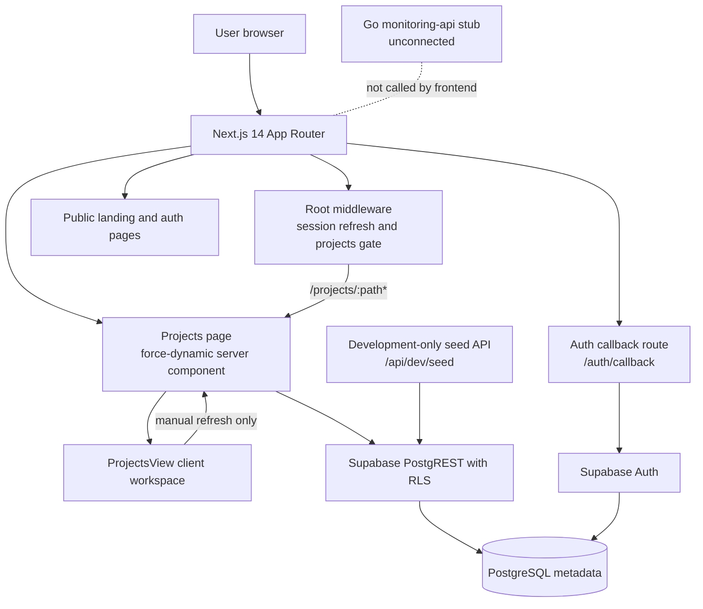

# PROJECT_TECHNICAL_CONTEXT.md

> Relatively stable technical context for **DevOps Safeguard**.
> Snapshot date: **2026-09-29**.
>
> This file records architecture, contracts, repository responsibilities, and
> guardrails that should change infrequently. For volatile delivery status,
> pending manual steps, test evidence, and roadmap, use
> `PROJECT_CURRENT_STATE.md`.

## 1. Product and current technical reality

**Implemented product:** a Next.js marketing site plus Supabase-backed
authentication and a project-list workspace.

**Intended product:** an open-source application/infrastructure monitoring,
failure-detection, correlation, incident-investigation, and AI-explanation
platform.

Do not confuse the two. The long-term architecture is specified in
`Docs/Architecture.md`, `Docs/Design.md`, and
`Docs/Screen_Navigation.md`, but the repository presently contains only its
foundation: landing content, auth, project metadata storage, project-list UI,
a Go HTTP stub, and database migrations.

Primary implemented users:

- Anonymous visitors reading the marketing site.
- Users creating accounts with email/password and a signup OTP.
- Signed-in users viewing RLS-scoped project metadata in `/projects`.

## 2. Canonical technology stack

| Layer | Technology | Exact version/source | Notes |
|---|---|---:|---|
| Frontend framework | Next.js App Router | `14.2.13` | `reactStrictMode: true`; `dynamic = "force-dynamic"` on `/projects` and dev seed route. |
| UI runtime | React / React DOM | `18.3.1` | Client/server components are mixed intentionally. |
| Language | TypeScript | `5.6.2` | Strict mode; `tsc --noEmit` is the type gate. |
| Styling | Tailwind CSS | `3.4.13` | Design tokens centralized in `tailwind.config.ts`. |
| CSS processing | PostCSS / Autoprefixer | `8.4.47` / `10.4.20` | Configured in `postcss.config.js`. |
| Fonts | Next `next/font/google` | `Inter`, `JetBrains Mono` | Loaded through CSS variables; no separate font package. |
| Icons | `lucide-react` | `^1.48.0` | Used for controls, health badges, refresh, demo, and auth affordances. |
| Animation | `motion` | `^13.4.4` | Used for auth/landing motion. |
| Class composition | `clsx`, `tailwind-merge` | `^2.1.1`, `^3.7.0` | Exposed through `lib/utils.ts` as `cn()`. |
| Backend language/runtime | Go | module requires `go 1.23` | Only stdlib `net/http`; no Go dependencies. |
| Backend framework | None | — | A minimal `http.ServeMux` stub, not a web framework. |
| Database | PostgreSQL | Local config uses major version `17` | Application metadata only; no telemetry store is implemented. |
| Auth/database provider | Supabase | `@supabase/supabase-js ^2.117.2`, `@supabase/ssr ^0.12.7` | Browser, server, middleware, callback, and dev seed clients. |
| Local Supabase CLI | Supabase CLI | Repository notes record `2.118.0`; not independently verified here | Configured by `supabase/config.toml`. |
| Package manager | npm | `package-lock.json` present | Install with `npm install`. |
| Linting | ESLint | `8.57.1` + `eslint-config-next 14.2.13` | `npm run lint`. |
| Type definitions | `@types/node`, `@types/react`, `@types/react-dom` | `20.16.10`, `18.3.5`, `18.3.0` | Development only. |
| Database tests | Plain PostgreSQL + `psql` + Docker | Test image `postgres:17-alpine` | Custom harness in `supabase/tests/run.ps1`. |
| Monitoring providers | None implemented | — | Prometheus, Loki, Tempo, Kubernetes, Falco, Trivy, and NATS appear only in docs/design copy. |
| AI provider/SDK | None implemented | — | No LLM API, prompts, embeddings, tools, MCP server, or costs exist in code. |

## 3. Implemented architecture

### 3.1 Runtime and request flow

Important boundaries:

- The frontend **does not call the Go backend**. The Go service answers only
  `/healthz` and remains architectural scaffolding.
- Supabase Auth is authoritative for authentication.
- PostgreSQL access from the app always goes through the Supabase anon key and
  RLS. There is no server-side service-role bypass in application code.
- No event bus, metrics backend, logs backend, tracing backend, Kubernetes
  integration, or AI runtime exists yet.

### 3.2 Authentication and data path

1. Middleware matches only `/projects/:path*`.
2. It skips the Supabase network round trip when no Supabase auth cookie is
   present, redirecting protected anonymous requests to
   `/login?next=/projects`.
3. When a cookie is present, it verifies the session and forwards the verified
   user ID in `x-safeguard-user-id`.
4. The server reads that header, fails closed when it is absent, and queries
   RLS-scoped Supabase rows.
5. Client components read the already-loaded session for display purposes only.

## 4. Repository responsibilities

| Path | Responsibility |
|---|---|
| `app/` | Next.js routes, layouts, loading UI, server components, and route handlers. |
| `app/page.tsx` | Public marketing landing composition. |
| `app/login/`, `app/register/` | Email/password and signup-code UI shells. |
| `app/auth/callback/route.ts` | Supabase PKCE/token-hash exchange and sanitized redirect. |
| `app/projects/` | Authenticated Projects Home page, skeleton, and metadata. |
| `app/api/dev/seed/route.ts` | Development-only sample-data creator/remover. |
| `app/layout.tsx`, `app/globals.css`, `app/icon.svg` | Global fonts, metadata, accessibility, favicon. |
| `components/landing/` | Static marketing sections and illustrative previews. |
| `components/auth/` | Session context, auth shell, OTP form, sign-out, user greeting. |
| `components/projects/` | Health visualization, project cards/table, search/filter/sort, refresh, demo controls, database notices. |
| `components/ui/` | Reused visual primitives: buttons, badges, cards, inputs, icons, terminal/animation utilities. |
| `lib/` | Domain model, formatting, constants, Supabase client factories, and class-name helper. |
| `lib/projects/demo-data.ts` | Six labeled sample projects for UI/demo purposes. |
| `supabase/migrations/` | Ordered PostgreSQL schema and RLS changes. |
| `supabase/tests/` | Throwaway-Postgres migration and policy tests. |
| `supabase/config.toml` | Local Supabase service configuration. |
| `backend/` | Unconnected Go control-plane stub. |
| `Docs/` | Architecture, design, navigation, auth setup, project state, and agent rules. |
| `Stitch Designs/` | HTML/design references used to derive the implemented UI. |
| `middleware.ts` | Narrow root matcher that delegates to Supabase middleware. |
| `package.json`, `package-lock.json` | Exact frontend dependency and script contract. |
| `next.config.js`, `tsconfig.json`, `postcss.config.js`, `.eslintrc.json` | Framework, compiler, CSS, and lint configuration. |
| `opencode.json` | Loads `Docs/RULE.md` into the coding agent. |
| `.env.example` | Public environment-variable template. |
| `.env`, `.env.local` | Ignored local environment files; values must not be committed. |
| `tsconfig.tsbuildinfo`, `.next/`, `node_modules/` | Generated or installed artifacts; do not edit. |

## 5. Stable domain and data contract

Implemented routes:

- `/`
- `/login`
- `/register`
- `/auth/callback`
- `/projects`
- `POST /api/dev/seed`
- `DELETE /api/dev/seed`

Planned but absent routes include `/projects/new`, `/projects/:projectId`,
forgot/reset-password, verification, incident/service/log/metric/alert,
deployment, security, AI-insight, report, settings, and account screens.

Implemented database domains:

- `auth.users`: managed by Supabase Auth.
- `public.profiles`: one row per user, created by trigger.
- `public.organizations`: tenant/workspace container.
- `public.organization_members`: caller-scoped membership with
  `owner`, `admin`, or `member` roles.
- `public.projects`: project metadata plus optional stored operational fields
  and `is_demo`.

Core table relationships:

- `profiles.id → auth.users.id`, cascade on delete.
- `organization_members.organization_id → organizations.id`, cascade.
- `organization_members.user_id → auth.users.id`, cascade.
- `projects.organization_id → organizations.id`, cascade.
- `projects.created_by → auth.users.id`, set null.
- Unique `projects(organization_id, slug)`.

RLS contract:

- Policies scope reads/writes to the caller.
- Recursive membership reads use `SECURITY DEFINER` functions scoped to
  `auth.uid()`.
- Self-onboarding is possible only inside organizations the caller created.
- Demo rows can be deleted through the caller's organization membership.

`ProjectSummary` contract:

- Missing health stays `null` and renders as **Unknown**, never Healthy.
- Missing counts render as `—`.
- Missing deployment renders as **Not available**.
- Missing last-checked time renders as **Never checked**.
- Sample rows set `isDemo: true` and must display sample-data labeling.

## 6. UI, accessibility, and data-integrity invariants

- Use the centralized Tailwind palette and existing UI primitives.
- Status must use icon/text/symbol in addition to color.
- Unknown telemetry must not be converted to Healthy.
- Sample data must be labeled as sample data.
- Every important async operation should handle loading, success, empty,
  error, permission-denied, and not-found states where applicable.
- Provide keyboard access, visible focus, labels, sufficient contrast, and
  reduced-motion behavior.
- `/projects` cards intentionally have no detail navigation because
  `/projects/:projectId` does not exist.

## 7. External-service boundary

Actually integrated:

- Supabase Auth, Supabase PostgREST/RLS, and PostgreSQL using the anon key.
- Supabase-hosted auth email, optionally routed through manually configured
  Resend SMTP.

Not integrated as live application services:

- Resend SDK/API, OAuth providers, GitHub/GitLab, Kubernetes, Docker,
  Prometheus, Loki, Tempo, OpenTelemetry, NATS, Falco, Trivy, SonarQube,
  Stripe, Slack, PagerDuty, or any LLM provider.
- Google branding in auth is an inline SVG notice-only button, not OAuth.
- Next.js may load Google Fonts at build/runtime through `next/font/google`.

## 8. Configuration contract

Declarations observed in `.env.example`:

- `NEXT_PUBLIC_APP_URL`
- `NEXT_PUBLIC_PRODUCT_NAME`
- `NEXT_PUBLIC_API_BASE_URL`
- `NEXT_PUBLIC_TELEMETRY_ENABLED`
- `NEXT_PUBLIC_SUPABASE_URL`
- `NEXT_PUBLIC_SUPABASE_ANON_KEY`

Application references observed in code:

- `NEXT_PUBLIC_APP_URL`: metadata base URL, with a localhost fallback.
- `NEXT_PUBLIC_SUPABASE_URL` and `NEXT_PUBLIC_SUPABASE_ANON_KEY`: all
  Supabase browser, server, middleware, callback, and seed paths.
- `NODE_ENV`: enables `/projects` development controls and makes
  `/api/dev/seed` return 404 in production.
- `PORT`: Go stub only, default `8080`.

Do not treat the other `.env.example` entries as implemented features. No
service-role key, OAuth secret, SMTP password, or AI key is used by
application code.

## 9. Durable security architecture

- Anonymous Supabase key only in browser-accessible paths.
- Supabase session cookies are the session mechanism; no custom tokens.
- Middleware is the server gate for `/projects`.
- Missing or unverifiable identity fails closed to login.
- Inbound auth headers are deleted before verification to prevent spoofing.
- Supabase callback redirects accept only internal `/...` destinations.
- OTP input accepts digits and requires exactly six characters.
- Database input is narrowed before rendering: unknown enums become `null`,
  invalid counts become `null`, and blank text becomes `null`.
- No secrets are committed; `.env`, `.env.local`, and `supabase/.temp/` are
  ignored.
- No production telemetry pipeline exists, so the UI must not invent it.

## 10. Important relatively stable decisions

- **Next.js App Router with mixed rendering:** static/marketing pages plus a
  dynamic authenticated project list.
- **Supabase as auth and metadata backend:** avoids building custom auth or a
  separate metadata API during Phase 1.
- **Anon key plus RLS, never browser service-role:** keeps row security on the
  database boundary.
- **Middleware header optimization:** avoids a second `auth.getUser()` round
  trip while preserving fail-closed behavior.
- **PostgreSQL for metadata only:** high-volume telemetry is explicitly out of
  scope for PostgreSQL by architectural design.
- **Static Go `/healthz` stub:** reserves the control-plane entry point
  without pretending that backend capabilities exist.
- **Labeled sample data instead of fabricated telemetry:** required by project
  data-integrity rules and implemented in both storage and UI.
